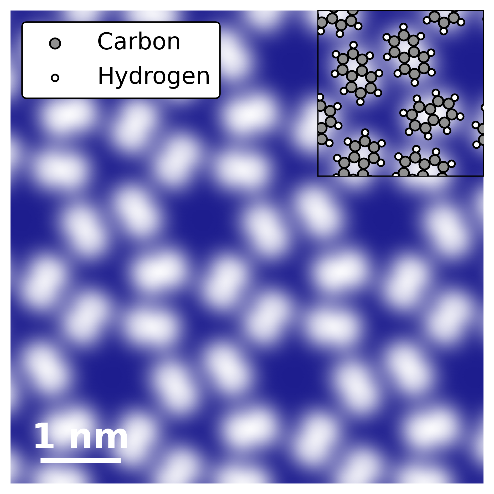

# Introduction

CubeSTM augments the Tersoff-Hamann method with *non-local tunneling*, *screening effect*, and *localization effect* to create STM images close to experimental observations. The Tersoff-Hamann method is commonly used for visualization of STM images from partial charge files, which states the tunneling current is proportional to the local density of states (LDOS) at the position of the tip, under the assumption that the potential of the STM tip is spherically symmetric. As a result, under the constant current mode, the STM topography can be interpreted as the isosurface of the LDOS. However, STM images simulated using the Tersoff-Hamann method do not always agree well with experimental observations, e.g. the edges are too sharp, and the shape of the electron densities may not agree. To address these deficiencies, we developed CubeSTM which utilizes a modified approach of the Tersoff-Hamann method. The mechanism of CubeSTM can be better understood under the constant height mode. Our considerations are:

- **Non-local tunneling**: All electron densities within a confined neighbourhood near the STM tip have a probability to contribute to the tunneling current, where the probability factor takes the form
```math
P_{non-local}(r) = \exp{(-\alpha\cdot r)},
```
where $r$ is the distance from a point to the position of the STM tip, and $\alpha$ is a parameter from user inputs. This modification effectively softens the edges of the electron densities, creating the same blurry effect as the experimental STM image.

- **Screening effect**: The higher the accumulated electron densities between a point and the STM tip, the less likely that point contributes to the tunneling current. This factor is written as
```math
P_{screening} = \exp{(-\beta\cdot\int\rho(\mathbf{r})d \mathbf{r})},
```
where $\int\rho(\mathbf{r})d\mathbf{r}$ is the summation of the local electron densities from the current point to the position of the STM tip, and $\beta$ is a parameter from user inputs.

- **Localization effect**: The higher the electron densities at one point, the less likely it contributes to the tunneling current. The form of this factor is
```math
P_{localization} = \exp{(-\gamma\cdot\rho(\mathbf{r})/\rho_{max})},
```
where $\rho(\mathbf{r})$ is the electron density at point $\mathbf{r}$, $\rho_{max}$ is the maximum local electron density in the system, and $\gamma$ is a parameter from user inputs. This consideration mainly address the localized electrons close to the nuclei, whose densities are several orders higher than outer-shell electrons but shouldn't contribute significantly to the tunneling current.

Please note that all mathematical forms of the above factors are chosen emperically, due to the lack of simple analytical expression of such effects. In real implementation of such algorithms, the electron densities are integrated only along the $z$ direction for simplicity, not along the direction to the STM tip. And by $\rho(\mathbf{r})$ and *local electron density*, we are refering to the charge density integrated from the Fermi level to the applied bias voltage.

The final expression of the tunneling current is thus
```math
I(\mathbf{r}) = \int_{ < r_{cut}}P_{non-local}\cdot P_{screening}\cdot P_{localization}\cdot \rho(\mathbf{r'})d\mathbf{r'},
```
where $\mathbf{r}$ is the position of the STM tip, and the integration runs over the neighbourhood whose cutoff distance $r_{cut}$ is determined by the user input.

![Illustration of relative contributions of electron densities to the tunneling current under different parameters in CubeSTM. The visualized area is a cross section in the $x-z$ plane, where the STM bias voltage is applied along the $z$ direction, namely the vertical direction in this figure. (a) The Tersoff-Hamann isosurface. (b) Screening effect off, localization effect off. (c) Screening effect off, localization effect on. (d) Screening effect on, localization effect off. (e) Screening effect on, localization effect on. (f) Screening effect magnified, localization effect magnified.](./figures/cubestm.png)

To illustrate how CubeSTM works, we take the electron densities of an isolated water molecule as an example, as shown in the figure. Panel (a) shows the isosurface plotted using the Tersoff-Hamann method. Panel (b) shows that without the screening effect and the localization effect, most contributions to the tunneling current come from the inner-shell electrons close to the nuclei, where the electron densities are several orders higher than outer-shell electrons. In panel (c), the localization effect is applied but not the screening effect. In this case the inner-shell electrons stay confined, yet we still see contributions from electrons even below the nuclei, which is not correct. In panel (d), the screening effect is applied but not the localization effect. We see that the screening effect alone includes similar effects as the localization effect, where inner-shell electrons are confined. Both the screening effect and the localization effect are applied in panel (e), which demonstrates the contributions of the electron densities to the tunneling current in CubeSTM have a similar distribution of an isosurface, but slightly delocalized to create similar effects as observed in experimental STM images. In the last panel (f), we greatly increase the strength of both the screening effect and the localization effect, which effectively visualizes the outer-shell electron distribution.

# Usage

**Before running CubeSTM, please make sure:**
1. The *x* and *y* lattice vectors of the volumetric data in `.cube` file is the same as the original atomic structure. 

   *This is to make sure the atoms and the supercell are plotted correctly. The program still generates a plot if the lattice vectors do not match, but the supercell will not look good.*
2. The lattice vectors should be of the form:
   ```math
   \begin{bmatrix} x_1 & x_2 & 0 \\ y_1 & y_2 & 0 \\ 0 & 0 & z_3 \end{bmatrix}.
   ```

The execution of CubeSTM is straightforward:
1. Import the class
```python
from cubestm import CubeSTM
```
2. Read files and create instance
```python
cube_path = './data/naph_cu_z6.cube'
geo_path = './data/naph_cu_z6.in'
instance = CubeSTM(cube_path, geo_path)
```
3. Make the plot
```python
instance.plot(show_atoms=['C', 'H'],
              canvas_height=60,
              canvas_width=60,
              neighbourhood=3,
              xy_decay=0.8,
              z_decay=1.,
              screening_power=10,
              localization_power=5,
              vmin=1e-2,
              vmax=1.0,
              sigma=2)
```


Other tunable parameters are explained in detail at the definition of the `plot` function in the source code.

# Citation
If you use this package, please cite:

Haoran Ni, Kevin Larkin, Wen Wen, Saeed Moayedpour, Rithwik Tom, Imanuel Bier, Derek Dardzinski, and Noa Marom.
Structure Prediction of Organic/Inorganic Interfaces with Genarris. ChemRxiv (2026).
DOI: 10.26434/chemrxiv.10002028/v1

BibTex:
```bibtex
@article{Ni2026GenarrisChemRxiv,
author = {Haoran Ni and Kevin Larkin and Wen Wen and Saeed Moayedpour and Rithwik Tom and Imanuel Bier and Derek Dardzinski and Noa Marom},
title = {Structure Prediction of Organic/Inorganic Interfaces with Genarris},
journal = {ChemRxiv},
volume = {2026},
number = {0208},
pages = {},
year = {2026},
doi = {10.26434/chemrxiv.10002028/v1},
URL = {https://chemrxiv.org/doi/abs/10.26434/chemrxiv.10002028/v1}}
```
